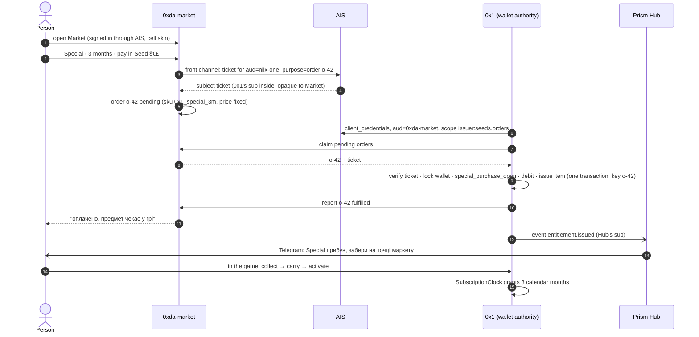

<!-- © 2026 aiaiaiai · aiaiaiai.org -->
<!-- SPDX-License-Identifier: Apache-2.0 -->

# The family protocol: how aiaiaiai products work together

Status: proposed (`family.v1`). Nothing here is deployed. Where a part already
exists in code, the section says so and names it.
Scope: AIS (this repository) and every product it signs people into: 0x1
(`nilx-one/*`), 0xda-market (`0xda-market/*`), Prism (`aiaiaiai-org/prism`,
`aiaiaiai-org/prism-hub`), and the products that come later.
Parent: [service design](service-design.md), ECO-0001.

## Why

The first cross-product purchase already works point to point: a person on
0xda-market buys **Special**, pays in **Seed ₴€£**, 0x1 debits the wallet,
grants the subscription or issues it as a thing that travels into the game.
It was built as one pair (0x1 ↔ Market) with its own secret, its own visit
handoff, its own vocabulary. The next pair (Market ↔ Prism, 0x1 ↔ Prism, a
fourth product) would repeat all of it. This document fixes the parts every
pair shares, so a new pair is configuration plus one adapter, not a new design.

## The rules

1. **One fact, one owner.** Every fact has exactly one authority, and only it
   writes the fact. Others hold copies, never truth.
2. **The authority commits atomically.** A debit and what it pays for are one
   transaction in the authority that owns the money. Nothing in between can
   take part in that transaction, so nothing sits in between.
3. **Navigation is never proof.** A browser coming back with an order id
   proves nothing. Proof is an authenticated server-to-server answer.
4. **At least once, idempotent everywhere.** Every command and event carries a
   stable id. A repeat confirms the first result; it never applies twice.
5. **Pairwise subjects.** A product knows a person only by its own `sub`. No
   product can join its users with another's without AIS saying so for one
   specific operation (see [the subject ticket](#the-subject-ticket)).
6. **No shared databases, no shared cookies.** Products talk over HTTPS with
   AIS-issued credentials, or through signed events.
7. **Additive versions.** `family.v1` only grows. A breaking change is
   `family.v2`, run in parallel until every consumer has moved.

## Who owns what

| Authority     | Owns                                                                                     | Never owns                     |
| ------------- | ---------------------------------------------------------------------------------------- | ------------------------------ |
| AIS           | people, `pub_dress`, password, sessions, provider bindings, pairwise `sub`, the registry of products and what each may do, the signing keys | money, items, any product state |
| 0x1           | the Bond, the Avaia, the **Seed ₴€£ wallet**, inventory, the subscription clock (Special, Exclusive), what a paid thing becomes in the game | prices, offers, checkout       |
| 0xda-market   | catalog, SKUs, prices, quotes, orders and their status, checkout, real-money payment providers | balances it does not issue, game state |
| Prism / Hub   | workspaces, channels, publications, delivery of messages to Telegram and other channels | identity (moving to AIS), money, game state |

A currency belongs to the product that **issues** it. Seeds are issued by 0x1,
so 0x1 is the only place that debits or credits them. Market sells things
priced in seeds, but it never holds a seed balance.

## The three channels

Every interaction between two products is one of three things. They are the
same three [service design](service-design.md#cross-service-no-tunnel) already
names for AIS; this document makes them the rule for product ↔ product too.

### 1. Sign-in (front channel)

OpenID Connect against `auth.aiaiaiai.org`: code + PKCE, pairwise `sub`, EdDSA
`id_token`. Exists (this repository, and `nilx-one/core` `aiaiaiai_sign_in`).
Every product signs people in only this way. 0xda-market and Prism Hub become
AIS clients like 0x1 (Market in the `cell` skin, Prism in `slug`).

### 2. Commands (back channel)

A product calls another product's API over HTTPS with an **AIS access token**
obtained by `client_credentials`:

```text
POST https://auth.aiaiaiai.org/token
grant_type=client_credentials
client_id=0xda-market
client_assertion_type=urn:ietf:params:oauth:client-assertion-type:jwt-bearer
client_assertion=<JWT signed with the product's own Ed25519 key>
scope=issuer:seeds.orders
audience=nilx-one
```

The token is an EdDSA JWT: `iss` AIS, `sub` the calling product, `aud` the
called product, `scope` what the registry allows this pair, `exp` ≤ 5 minutes,
`jti`. The called product verifies it with the JWKS it already caches for
sign-in. No per-pair shared secrets: a product's private key never leaves it,
and AIS can revoke a pair by editing the registry.

Every command carries an `Idempotency-Key` (the business id, for example the
order id). Commands are state transitions with a fixed set of answers; a
replay answers what the first call answered.

Exists in part: Market ↔ 0x1 already uses server-to-server calls, today
authenticated with an HMAC over a shared handoff secret
(`nilx-one/core` `market_issuer`). That keeps working; it moves to AIS tokens
in its own change.

### 3. Events (fan-out)

When an authority changes a fact others copy, it writes an event to an outbox
**in the same transaction** as the change and delivers it to each subscribed
product. One envelope for every product:

```json
{
  "spec": "family.v1",
  "id": "01JD7Q8M3K6ZB9R2T4V5W7X8Y0",
  "type": "commerce.order.fulfilled",
  "source": "0xda-market",
  "time": "2026-11-11T12:00:00Z",
  "subject": "<the receiver's pairwise sub, or absent>",
  "data": { }
}
```

Delivery: `POST` to the receiver's registered events URL, body signed as a
compact JWS (EdDSA, the sender's registered key; the receiver checks it against
AIS's registry JWKS for that product). At least once; the receiver
deduplicates by `id`. A `subject` is always the receiver's own pairwise `sub`,
never another product's and never AIS's private identifier. If volume ever
asks for a broker, NATS JetStream can carry the same envelopes unchanged.

## The registry

AIS's client registry (`AIS_CLIENTS`, [runtime](runtime.md#clients)) grows
from "who may sign people in" into "who is in the family and what each may do".
New members, all optional, so today's entries stay valid:

```json
{
  "client_id": "0xda-market",
  "name": "0xda-market",
  "skin": "cell",
  "redirect_uris": ["https://0xda-market.nilx.one/auth/callback"],
  "family": {
    "jwks_uri": "https://0xda-market.nilx.one/.well-known/jwks.json",
    "events_uri": "https://0xda-market.nilx.one/family/events",
    "issues": [],
    "may_call": { "nilx-one": ["issuer:seeds.orders"] },
    "subscribes": ["identity.*", "wallet.*"]
  }
}
```

`issues` lists the denominations a product is authority for (`nilx-one`:
`["seeds"]`). `may_call` is the whole permission model between products: AIS
mints a command token only for a pair and a scope listed here. Adding a fourth
product is one registry entry.

## The subject ticket

Pairwise `sub` means Market's `sub` for a person is not 0x1's. When Market has
to tell 0x1 *who* receives a purchase, it needs 0x1's name for that person,
for this one order, and nothing else.

A **subject ticket** is a short JWT AIS mints at the end of a front-channel
step the person is present for:

| Claim  | Value                                                    |
| ------ | -------------------------------------------------------- |
| `iss`  | `https://auth.aiaiaiai.org`                              |
| `aud`  | the authority that will act (`nilx-one`)                 |
| `sub`  | the person's pairwise `sub` **for the audience**         |
| `azp`  | the product that asked (`0xda-market`)                   |
| `purpose` | `order:<order id>`                                    |
| `exp`  | 15 minutes, the life of an order's authorization         |
| `jti`  | unique; the audience accepts it once                     |

The asking product cannot read anything useful from it (the `sub` is not
its own) and cannot reuse it for another order. The audience verifies it with
the JWKS it already has. It replaces `pub_dress` as the join key, which breaks
on a rename or a prefix change.

The ticket is the general case. The 0x1 **visit** (`nilx-one/core`
`market_visit`) stays as the path for a person who starts in 0x1: 0x1 already
knows them, opens the visit and hands Market a one-time code. Both end in the
same order shape.

## Commerce: one order, any issuer

Market's order is the shared object for every purchase in the family. The
fields are the ones the 0x1 issuer already reads; `family.v1` names them:

| Field             | Meaning                                                         |
| ----------------- | --------------------------------------------------------------- |
| `id`              | Market's order id; the idempotency key everywhere downstream    |
| `sku`             | `<issuer>_<product>_<term>`, e.g. `0x1_special_3m`              |
| `issuer`          | the product that fulfils it, a registry `client_id`'s product   |
| `denomination`    | what pays: `seeds` (issuer 0x1), later fiat through Market's PSP |
| `price_id`, `amount_minor` | the quote Market fixed; never recomputed downstream    |
| `term`            | `{ "months": 3, "policy": "calendar_months_utc" }` for time      |
| `recipient`       | a subject ticket, or the visit link `{provider: "nilx_visit", id}` |
| `status`          | `pending` → `processing` → `fulfilled` \| `rejected`            |

The issuer **pulls**: it claims `pending` orders from Market's issuer API,
re-checks everything under its own lock, commits debit and grant together keyed
by `id`, and reports the outcome. Market never calls into the issuer's wallet,
and a crash after the commit only leads to a repeated `fulfilled`, never a
second debit. This is what `nilx-one/core` `market_issuer` does today; the
protocol keeps it.

Rejections are a closed list shared by every issuer: `invalid_terms`,
`recipient_unknown`, `recipient_expired`, `recipient_mismatch`,
`insufficient_funds`, `session_changed`, `account_unlinked`, `already_active`.
0x1's current codes map one to one (`visit_*` → `recipient_*`,
`insufficient_seeds` → `insufficient_funds`, `special_active` →
`already_active`). None of them follows a debit.

## Entitlement: what the person gets, and how it reaches the game

A fulfilled order produces an **entitlement** in the issuer. The issuer alone
decides how it is embodied; the protocol only fixes its life:

```text
issued → in_transit → stored → activated
```

For 0x1 this already exists as `paid_special_items` (`paid`, `in_transit`,
`stored`, `activated`): the paid Special arrives as a thing that can be
collected at a Market point, carried in the grid, handed to the Avaia, and
activated, which starts the subscription clock. Market sees only `fulfilled`;
the item's journey through the game is 0x1's business and is published as
`entitlement.*` events for whoever subscribes (Prism Hub, to tell the person).

## End to end: Special for seeds, bought on Market



Steps 3–4 and 6 are new (the ticket and AIS command tokens). Everything from
step 7 on exists in `nilx-one/core` today with the visit and HMAC in their place.

## Is Prism Hub the connector?

No, not for money or entitlements; yes, for telling people about them.

- **The connector is the protocol plus AIS's registry, not a service.** A
  broker between Market and 0x1 cannot take part in 0x1's transaction (rule 2).
  It can only relay, which adds a hop that can fail, a third holder of
  credentials, and a place where an order can sit "paid but not delivered".
- **Prism Hub's own boundaries say so.** It orchestrates publication and
  delivery; `prism/docs/ecosystem.md` forbids client-domain concepts in Prism
  and shared state between products, and Hub's human identity is already
  moving to AIS (`prism-hub/docs/identity.md`).
- **What Hub is good at is exactly the last mile.** Prism Porter turns
  versioned artifacts into delivery intents for channels. In the family, Hub
  subscribes to `commerce.*` and `entitlement.*` events and turns them into
  messages (Telegram, later others). It reads events; it never commands a
  wallet.

If one day the family needs a central place, it is an event bus under the same
envelopes (NATS JetStream), still with no business logic in it.

## Event types in `family.v1`

| Type                          | Source      | Meaning                                       |
| ----------------------------- | ----------- | --------------------------------------------- |
| `identity.created`            | AIS         | a person exists for this product              |
| `identity.prefix_changed`     | AIS         | the public address moved; `sub` did not       |
| `identity.deleted`            | AIS         | erase this `sub`'s data                       |
| `commerce.order.fulfilled`    | Market      | an order reached its final good state         |
| `commerce.order.rejected`     | Market      | final refusal, with the shared code           |
| `wallet.debited`              | 0x1         | seeds left a wallet, with the order id        |
| `entitlement.issued`          | issuer      | the person owns a thing or a term             |
| `entitlement.state_changed`   | issuer      | `in_transit`, `stored`, `activated`           |
| `subscription.changed`        | 0x1         | the effective tier or its deadline moved      |

A consumer that does not know a type ignores it.

## What exists and what is to build

Exists:

- AIS sign-in and issuer (this repository); `aiaiaiai_sign_in` in `nilx-one/core`.
- Market visit, issuer worker, atomic debit + Special grant, paid Special items
  and their life in the game (`nilx-one/core` `market_visit`, `market_issuer`,
  `repository_subscriptions`, migration 0043).
- Core's subscription rules: `special_seeds_term_months`,
  `special_purchase_open`, `SubscriptionClock`.

To build, each its own pull request, in this order:

1. **AIS**: the `family` member of the registry, `client_credentials` with
   `private_key_jwt`, and the product JWKS lookup.
2. **AIS**: the subject ticket endpoint.
3. **AIS**: the event outbox and signed delivery (already in the first-release
   scope as `identity.*`).
4. **0xda-market**: sign-in through AIS; tickets on orders; issuer API accepts
   AIS tokens next to the HMAC.
5. **0x1** (`nilx-one/core`): accept a ticket as the recipient; call Market with
   AIS tokens; emit `wallet.*`, `entitlement.*`, `subscription.changed`.
6. **Prism Hub**: an events endpoint and a Porter route for `commerce.*` and
   `entitlement.*` to Telegram.
7. **infra**: registry entries and product keys in host-owned secrets; then the
   HMAC handoff secret is retired.

## Open questions

1. Name: `family.v1`, or another name the owner prefers for the protocol.
2. Whether the subject ticket needs an explicit consent screen on first use
   for a pair, or whether the purchase confirmation is consent enough.
3. Fiat: whether Market stays the only merchant of record for real money (for
   example the legendary craft's `finish_paid`), with the issuer seeing only
   `denomination: "uah"` orders already paid.
4. Whether `0x1` as an issuer name and `nilx-one` as its `client_id` should be
   unified to one identifier.

---

© 2026 aiaiaiai · aiaiaiai.org
